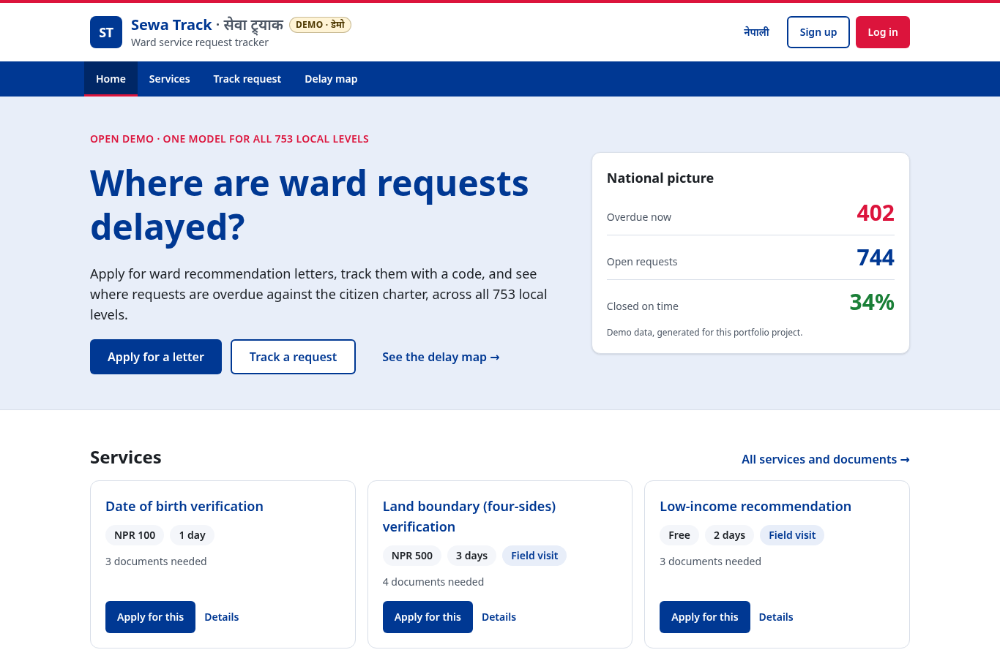
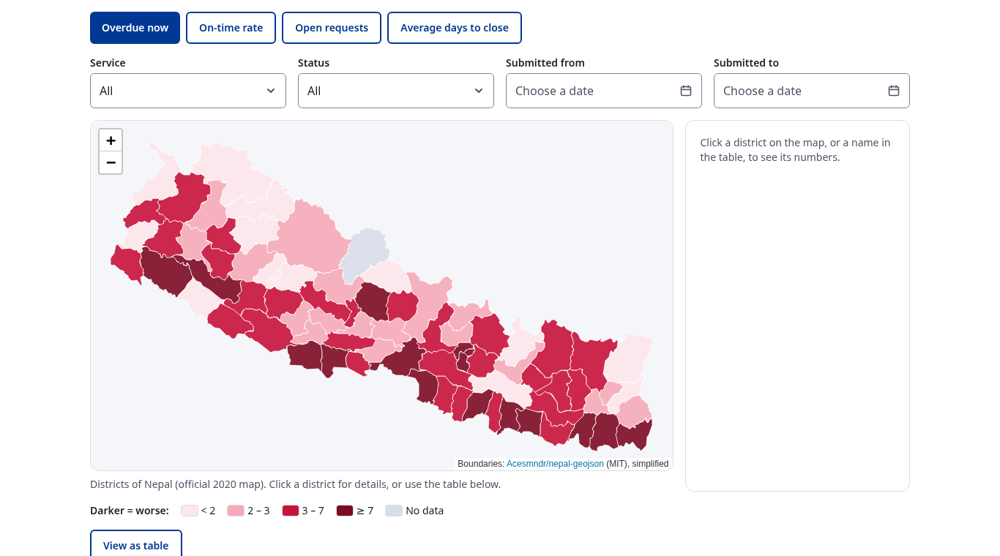
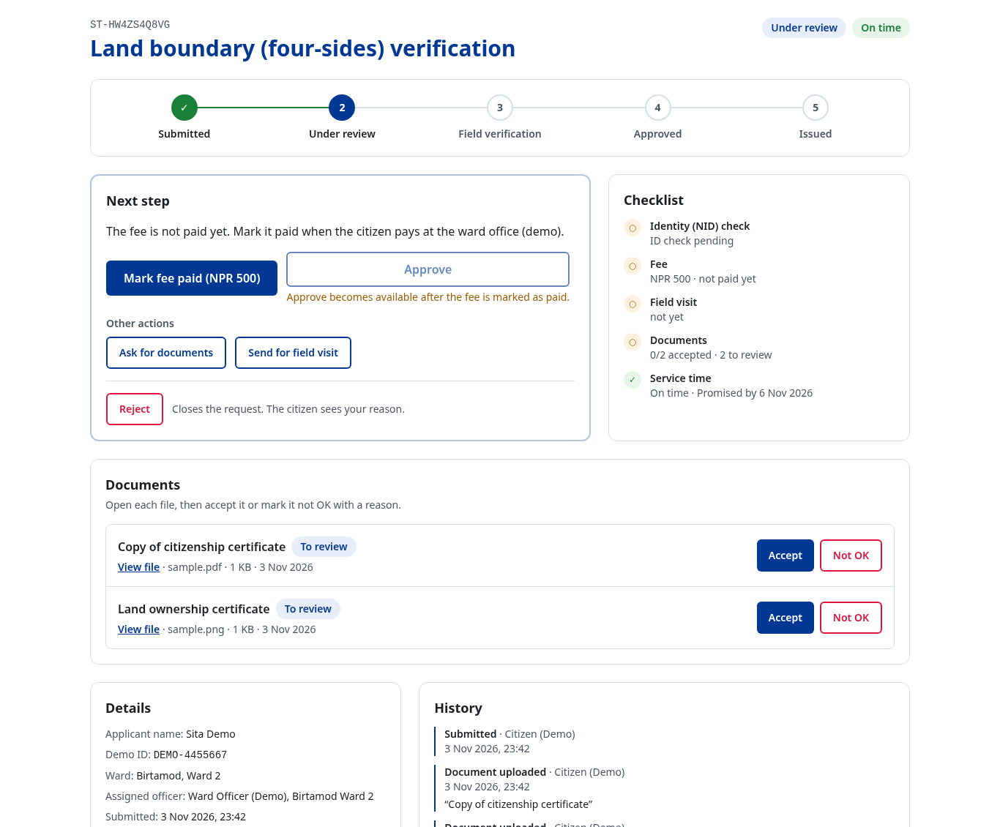
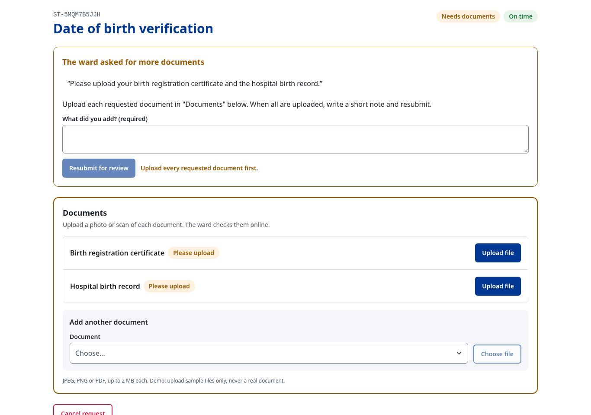
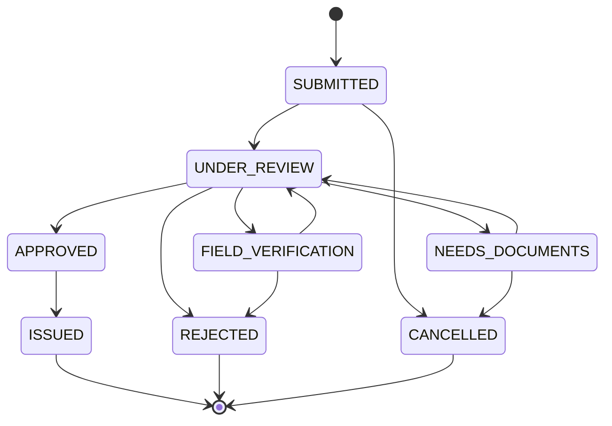
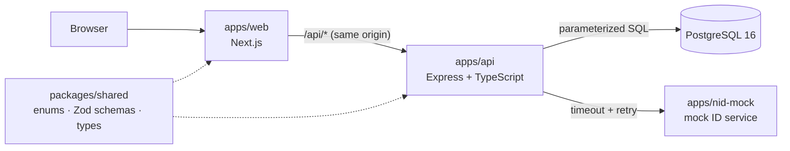

# Sewa Track

> **Demo / portfolio project. Not affiliated with any government body. Do not enter real information.**
> **डेमो / पोर्टफोलियो परियोजना। कुनै पनि सरकारी निकायसँग सम्बन्धित छैन। वास्तविक जानकारी नराख्नुहोस्।**

[](https://github.com/darshanbajgain/sewa-track/actions/workflows/ci.yml)


**An open, national citizen-service tracker for Nepal's ward recommendation letters (वडा सिफारिस),
with a service-delay map that shows where requests are overdue against the citizen charter.**

Online sifaris already exists in parts of Nepal, but each palika uses a different system and the
data isn't connected. Sewa Track explores an open, national version: **one data model for all 753
local levels**, **delay tracking against charter times on a national map**, and clean integration with
existing services, built with tests, an audit log and documentation.

**Live demo: <https://sewa-track.vercel.app>** · API docs: <https://sewa-track.vercel.app/api/docs>
(free hosting: the first request after a quiet spell can take ~30 s while the server wakes up).
Try it with the [demo accounts](#demo-accounts) or sign up as a citizen.

| Home | National service-delay map |
|---|---|
|  |  |
| **Ward officer: one clear next step** | **Citizen: upload what the ward asked for** |
|  |  |

---

## Contents

- [What it does](#what-it-does)
- [Status](#status)
- [Architecture](#architecture)
- [Tech stack](#tech-stack)
- [Quick start](#quick-start)
- [Project structure](#project-structure)
- [Engineering highlights](#engineering-highlights)
- [Documentation](#documentation)
- [Existing systems](#existing-systems)
- [Data sources and credits](#data-sources-and-credits)
- [License](#license)

---

## What it does

| Who | Can |
|---|---|
| **Citizen** | See required documents and fees, apply online and attach documents (JPEG/PNG/PDF), track with a code (no login), upload what the ward asks for and resubmit |
| **Ward officer** | Work through the ward's queue; each request shows a progress bar, **one clear next step**, a checklist, and the documents to accept or mark "not OK"; every move follows a strict, audited workflow |
| **Palika admin** | See all wards of the palika, reassign officers, view reports |
| **System admin / public** | See the **national service-delay map**: overdue requests and on-time rate by district and palika |

The request workflow:



Five demo services: relationship, residence, low-income, land boundary (चार किल्ला) and date of
birth verification. **Fees and service days are demo values** based on public citizen charters
and may be outdated.

---

## Status

| Area | Status |
|---|---|
| Monorepo, shared types, CI (type-check, tests on Postgres, build, dependency audit) | ✅ |
| API foundation: health check, standard errors, request ids, structured logs, graceful shutdown, security headers | ✅ |
| Database: full schema, constraints, append-only audit log, own migration runner | ✅ |
| Reference data: 7 provinces, 77 districts, 753 local levels, 6,743 wards, 5 services | ✅ |
| Workflow rules (transitions, overdue, tracking codes, fee payment), 160+ unit tests | ✅ |
| Auth: login with httpOnly JWT cookie, role checks, login rate limit, demo accounts | ✅ |
| Public API: service catalog and location hierarchy (province → district → palika → ward) | ✅ |
| Request submission (one transaction with audit event) and "my requests" | ✅ |
| Public tracking by code (no login, no personal data, rate limited) | ✅ |
| Staff queue (scoped by ward/palika, filters, pagination) and request detail | ✅ |
| Status changes + fee paid: transition rules, optimistic locking (409), audit in the same transaction, notifier stub | ✅ |
| Map statistics API: overdue, on-time rate, pending, avg days per district/palika + staff reports | ✅ |
| Interactive API docs: OpenAPI 3.1 + Swagger UI at `/api/docs`, generated from the same Zod schemas | ✅ |
| Performance on 100k requests: indexes from EXPLAIN ANALYZE, measured before/after (queue 7.9 → 0.5 ms) | ✅ |
| Web app foundation: portal layout, English/Nepali, home with live national numbers, services, public tracking, login | ✅ |
| Accounts: citizen sign-up, email login, demo mode, system admin creates/deactivates staff accounts (deactivation is immediate) | ✅ |
| One portal per role: `/citizen`, `/ward`, `/palika`, `/admin` (users page: add staff, deactivate) | ✅ |
| Citizen portal: my requests, apply (cascading dropdowns, shared validation), detail with resubmit/cancel and 409 handling | ✅ |
| Staff portal: queue (filters in the URL, paging), detail with only the allowed actions, fee paid, 409 handling, palika/national reports | ✅ |
| National delay map: district choropleth (official 2020 boundaries), 4 measures, filters, side panel, legend, table view | ✅ |
| Supporting documents: officer names what's needed, citizen uploads, officer accepts / "not OK"; type checked from the file's bytes | ✅ |
| Staff request screen: progress bar, one next step, checklist; separate citizen and staff login pages; role-only menus | ✅ |
| UI polish: accessible dropdowns and date picker, skeleton loading (no layout jumps), scrolling table cards | ✅ |
| Integration with a mock National ID service: 2 s timeout, 2 retries with backoff, contract test, check runs after the reply (PRD F9) | ✅ (live: off until hosted) |
| Live demo ([sewa-track.vercel.app](https://sewa-track.vercel.app)): web on Vercel, API on Render, Postgres on Neon; demo data reset with `pnpm demo:reset` | ✅ |

---

## Architecture



The API is layered `routes → controllers → services → repositories`, with the core business rules
as pure functions in `domain/`. Full design: [docs/architecture.md](docs/architecture.md).

---

## Tech stack

| Part | Technology |
|---|---|
| Language / runtime | TypeScript (strict), Node.js 22 LTS |
| Monorepo | pnpm workspaces |
| API | Express 5, Zod, pino, helmet |
| Database | PostgreSQL 16 with `pg` and hand-written, parameterized SQL (no ORM); plain SQL migrations |
| Web | Next.js 16 (App Router), React 19, Tailwind CSS 4, TanStack Query 5, Leaflet (map, planned) |
| Tests | Vitest + Supertest against a real Postgres |
| Infra | Docker (multi-stage, non-root images), Docker Compose, GitHub Actions (CI) |

---

## Quick start

Prerequisites: **Node.js ≥ 22.23.4**, **pnpm 10**, **Docker**.

```bash
pnpm install
cp .env.example .env
docker compose up -d db
pnpm db:migrate && pnpm db:seed
pnpm dev
```

Then open the **web app** at <http://localhost:3000> (log in with a demo account), or the **interactive API
docs (Swagger UI)** at <http://localhost:4000/api/docs>. Run the tests with `pnpm test`.

**Or run everything in containers** (production builds, migrations run first):
`cp .env.example .env && docker compose up --build`, then open <http://localhost:8080>.
Details: [docs/deployment.md](docs/deployment.md).

### Demo accounts

All accounts are **fake** and use the password **`demo1234`**.

| Email | Role |
|---|---|
| `citizen@example.com` | Citizen (Demo) |
| `officer.birtamod2@example.com` | Ward Officer (Demo), Birtamod Ward 2 |
| `palika.birtamod@example.com` | Palika Admin (Demo), Birtamod |

The **system admin** is private: set `SEED_ADMIN_EMAIL` and `SEED_ADMIN_PASSWORD` in `.env` before
`pnpm db:seed` to create one locally. The delay map's numbers come from sample requests (none in Birtamod).

Citizens can also **sign up** at `/register`; staff accounts are created by the system admin. New accounts
must use an `@example.com` email (a domain reserved for examples), so the demo never stores a real address.

```bash
curl -c cookies.txt -X POST localhost:4000/api/v1/auth/login \
  -H 'Content-Type: application/json' -d '{"email":"officer.birtamod2@example.com","password":"demo1234","portal":"STAFF"}'
curl -b cookies.txt localhost:4000/api/v1/auth/me
```

---

## Project structure

```
apps/
  api/            Express REST API (src/, SQL migrations, seed data, tests)
  web/            Next.js frontend (public pages, login, citizen and staff portals)
  nid-mock/       mock "existing ID service": slow, sometimes down, on purpose (PRD F9)
packages/
  shared/         enums, Zod schemas and types used by api and web
docs/             requirements, architecture, database, codebase guide
.github/          CI workflow
```

---

## Engineering highlights

- **The database protects itself:** `CHECK`, foreign key and unique constraints; a role-scope rule
  (a ward officer must have exactly one ward); `closed_at` set exactly when a request is final.
- **Append-only audit log:** a trigger rejects any `UPDATE` or `DELETE` on the history table.
- **Optimistic locking:** two officers editing the same request get one success and one `409 Conflict`,
  never a silent overwrite.
- **Hand-written SQL, measured:** on 100k fake requests, indexes chosen from `EXPLAIN ANALYZE` made the officer
  queue ~15× and request history ~190× faster; API p95 is 5 ms (queue) and 66 ms (national map).
  The honest part is in [performance.md](docs/performance.md): the national map needs every row, so no index helps it.
- **Own migration runner:** one transaction per file, checksum check, advisory lock (same model as Flyway).
- **Security basics from day one:** input validation, generic error responses, log redaction, request
  size limit, compressed request bodies refused, dependency audit in CI, patched Node.js required.
- **File uploads treated as hostile:** the type is decided from the file's first bytes (a renamed `.exe` is
  refused), 2 MB limit while streaming, cleaned file names, and downloads sent with `nosniff`, `CSP: sandbox`
  and `no-store`; every upload and review is audited in the same transaction.
- **Measured UI stability:** skeleton placeholders keep Chrome's layout-shift score under 0.01 on every page.
- **Tests against a real database**, not mocks; each test runs in a rolled-back transaction.

---

## Documentation

| Document | What's inside |
|---|---|
| [docs/PRD.md](docs/PRD.md) | Requirements and scope |
| [docs/architecture.md](docs/architecture.md) | System design: containers, layers, flows, security, deployment |
| [docs/database.md](docs/database.md) | ER diagrams, every table and data type, design decisions, migrations, seed |
| [docs/api.md](docs/api.md) | Every endpoint: request, response, errors, curl examples (live version: `/api/docs`) |
| [docs/performance.md](docs/performance.md) | 100k-row benchmarks: EXPLAIN ANALYZE before/after indexes, API p95, index cost |
| [docs/frontend.md](docs/frontend.md) | Web app: folder structure, data flow, design system, components, accessibility, security, portals and routing |
| [docs/deployment.md](docs/deployment.md) | Docker images, the migration release step, settings, real client IPs behind proxies |
| [docs/codebase-guide.md](docs/codebase-guide.md) | How to read the code, where things are, how to add an endpoint |
| [docs/decisions/](docs/decisions/) | Architecture decision records (ADR-001 location copies, ADR-002 optimistic locking, ADR-003 accounts) |
| [docs/incidents/](docs/incidents/) | Blameless reviews (001: a concurrency test that passed for the wrong reason) |
| [CHANGELOG.md](CHANGELOG.md) | What changed in each release |
| [SECURITY.md](SECURITY.md) | How to report a vulnerability, what's in place, testing rules for the live demo |

---

## Existing systems

Online ward recommendation services already exist in parts of Nepal, for example vendor platforms
that wards subscribe to individually and city systems such as Kathmandu Metropolitan City's.
Sewa Track does not replace or claim to be the first of these; it explores what an **open,
shared** model could add: comparable data across all 753 local levels and a national view of
service delays. Details: [PRD §2.1](docs/PRD.md#21-existing-systems-and-how-sewa-track-differs).

---

## Data sources and credits

- **Provinces, districts, local levels and ward counts:**
  [sagautam5/local-states-nepal](https://github.com/sagautam5/local-states-nepal), MIT License,
  © 2020 Sagar Gautam. Pinned version, changes and full license notice:
  [apps/api/db/seed-data/README.md](apps/api/db/seed-data/README.md).
- **District boundaries (delay map):** [Acesmndr/nepal-geojson](https://github.com/Acesmndr/nepal-geojson),
  MIT License, © 2018 Aashish Manandhar. Follows Nepal's official 2020 map (including Lipulekh, Kalapani and
  Limpiyadhura; checked, see [seed-data/README.md](apps/api/db/seed-data/README.md#district-boundaries)).
  Simplified, not survey-grade. Built by `apps/api/src/db/import-district-map.ts`.
- **All people, emails, phone numbers and IDs in the demo are fake.** IDs are prefixed `DEMO-`.

---

## License

[MIT](LICENSE) © 2026 Darshan Bajgain. Third-party data keeps its own license (see above).
