# Architecture and System Design

> **Demo / portfolio project. Not affiliated with any government body. All data is fake.**

How Sewa Track is put together, how a request flows through it, and why it is designed this way.

- Requirements: [`PRD.md`](./PRD.md) · Database: [`database.md`](./database.md) · Code map: [`codebase-guide.md`](./codebase-guide.md)
- Status markers: ✅ built · 🔜 planned (designed here, implemented in a later phase)

> Diagrams use **Mermaid** (GitHub renders them; in VS Code install "Markdown Preview Mermaid Support").

## Contents

1. [Goals and quality attributes](#1-goals-and-quality-attributes)
2. [System context](#2-system-context)
3. [Containers (the running pieces)](#3-containers-the-running-pieces)
4. [Inside the API: layers and components](#4-inside-the-api-layers-and-components)
5. [The request workflow (state machine)](#5-the-request-workflow-state-machine)
6. [Key flows, step by step](#6-key-flows-step-by-step)
7. [Authentication and authorization](#7-authentication-and-authorization)
8. [Data consistency](#8-data-consistency)
9. [Integration with the ID service](#9-integration-with-the-id-service)
10. [Errors, logging and observability](#10-errors-logging-and-observability)
11. [Security and privacy](#11-security-and-privacy)
12. [Performance and scalability](#12-performance-and-scalability)
13. [Deployment and CI/CD](#13-deployment-and-cicd)
14. [Key decisions and trade-offs](#14-key-decisions-and-trade-offs)
15. [Build status](#15-build-status)

---

## 1. Goals and quality attributes

| Quality | What it means here | How the design achieves it |
|---|---|---|
| **Correctness** | A request can only move along allowed steps | One pure transition function + DB constraints |
| **Auditability** | Every change is recorded and can't be altered | Audit row in the same transaction; append-only trigger |
| **Security** | Staff see and change only their own scope | Server-side role + scope checks on every route |
| **Privacy** | Public endpoints never expose personal data | Public tracking returns a fixed, minimal field list |
| **Consistency** | Two officers can't overwrite each other | Optimistic locking with a `version` column |
| **Resilience** | An outside service failing doesn't block citizens | Timeout + retry; submission succeeds anyway |
| **Performance** | Map and queue stay fast at 100k+ requests | Copied location ids, composite indexes, one `GROUP BY` |
| **Maintainability** | Easy to read, test and change | Thin layers, typed shared contracts, docs + tests per change |

---

## 2. System context

Who uses the system and what it talks to.

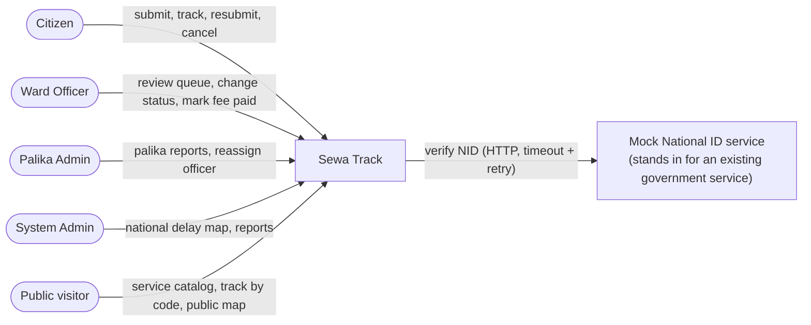

---

## 3. Containers (the running pieces)

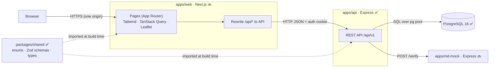

| Container | Tech | Responsibility | Port (local) |
|---|---|---|---|
| `apps/web` 🔜 | Next.js App Router, Tailwind, TanStack Query, react-leaflet | UI in Nepali/English; calls the API; never talks to the DB | 3000 |
| `apps/api` ✅ | Express 5, TypeScript, Zod, `pg`, pino | All business rules, auth, validation, SQL | 4000 |
| PostgreSQL ✅ | Postgres 16 | Source of truth; enforces constraints | 5432 |
| `apps/nid-mock` 🔜 | Express | Simulates a slow, sometimes failing external ID service | 5000 |
| `packages/shared` ✅ | TypeScript + Zod | One definition of statuses, codes, schemas, error shape | — |

**Why the web app proxies `/api/*` to the API (same origin):** the login cookie is
`SameSite=Lax`. If the web (e.g. `*.vercel.app`) and the API (e.g. `*.onrender.com`) were called
as two different sites, the browser would not send the cookie on API calls. With a Next.js
rewrite, the browser only ever talks to the web origin, so the cookie works and CORS stays simple.

---

## 4. Inside the API: layers and components

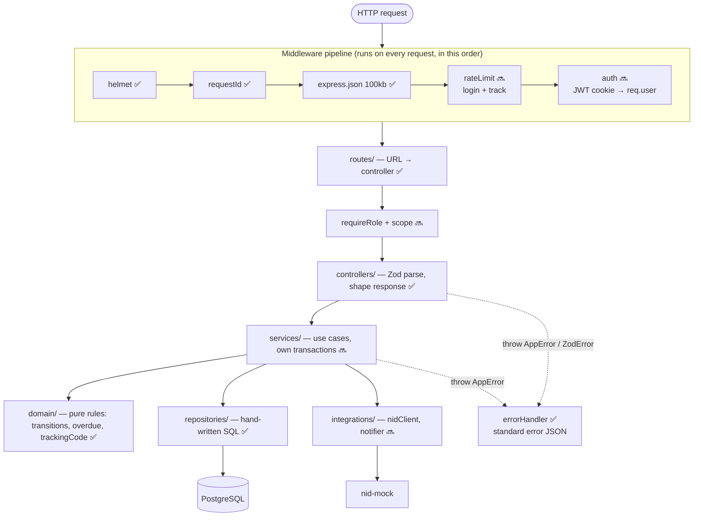

| Layer | Knows about | Must NOT | Example |
|---|---|---|---|
| `routes/` | URL + method | contain logic | `POST /requests/:id/transitions` → `transitionController` |
| `controllers/` | HTTP (`req`, `res`), Zod | run SQL | parse `{toStatus, version, note}`, call service, send 200 |
| `services/` | use case steps, transactions | know about HTTP | load request → check rule → update + audit in one transaction |
| `domain/` | pure business rules | import `pg` or Express | `canTransition(from, to, actor, request)` → allowed / reason |
| `repositories/` | SQL | contain business rules | `updateStatusWithVersion(client, id, version, status)` |
| `integrations/` | outside systems | leak their errors | `verifyNid()` with timeout + retry → `MATCH`/`FAILED` |

**Dependency rule:** arrows only point down. That's why `domain/` can be unit-tested with no
database, and SQL can change without touching business rules.

---

## 5. The request workflow (state machine)

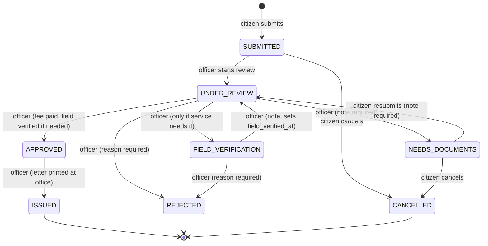

- Defined **only** in `apps/api/src/domain/transitions.ts` ✅; anything else → `422 INVALID_TRANSITION`.
- Final states (`ISSUED`, `REJECTED`, `CANCELLED`) set `closed_at` (also enforced by a DB constraint).
- **Overdue** = not final AND `now() > submitted_at + service_days`.
- **On-time rate** = requests closed within `service_days` ÷ all closed requests.

---

## 6. Key flows, step by step

### 6.1 Health check ✅
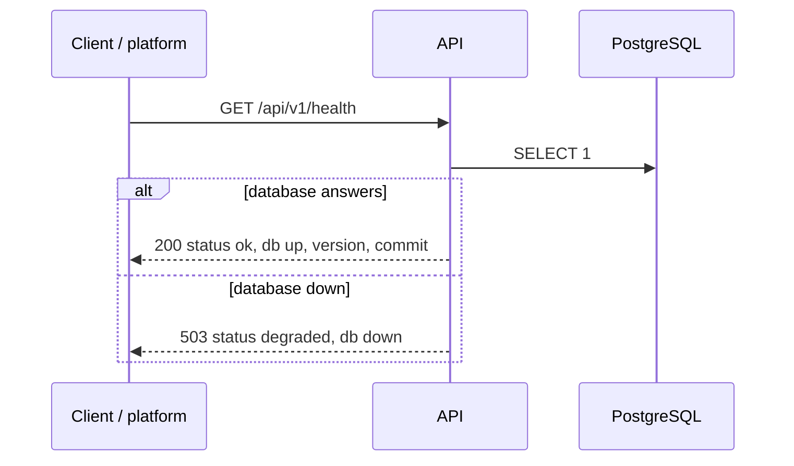

### 6.2 Login 🔜
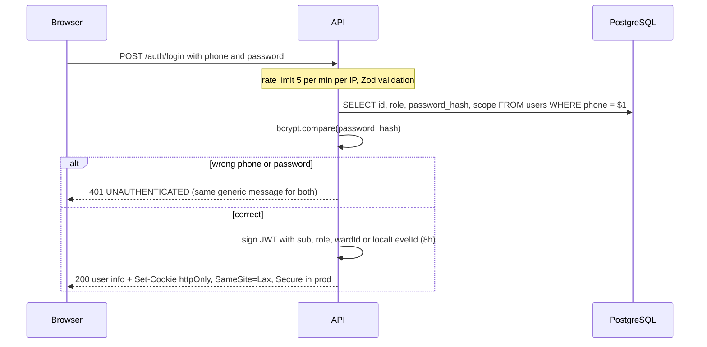
The same message for "unknown phone" and "wrong password" stops attackers from finding which
phone numbers have accounts.

### 6.3 Citizen submits a request 🔜
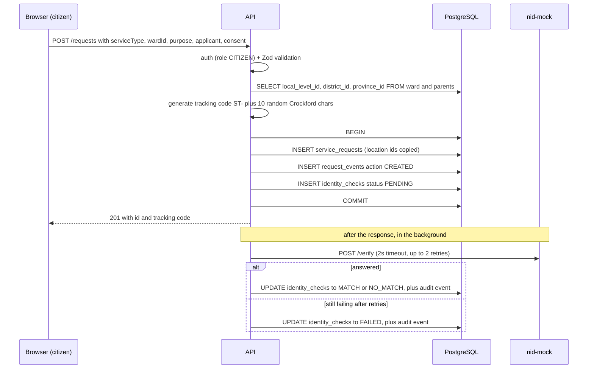
A tracking-code collision (extremely unlikely) hits the `UNIQUE` index; the service retries
with a new code.

### 6.4 Public tracking 🔜
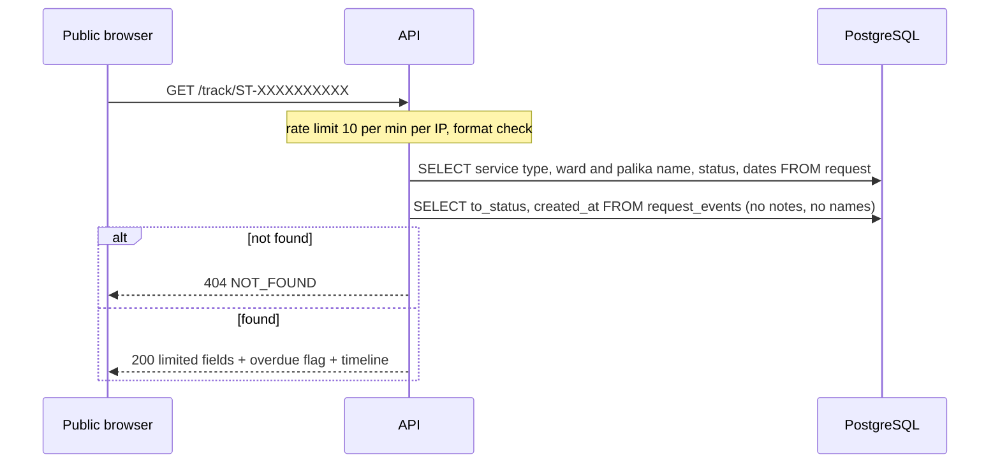
The SQL selects only allowed columns, so personal data can't leak even by accident. A test
asserts the response contains no applicant fields.

### 6.5 Officer changes a status (the core flow) 🔜
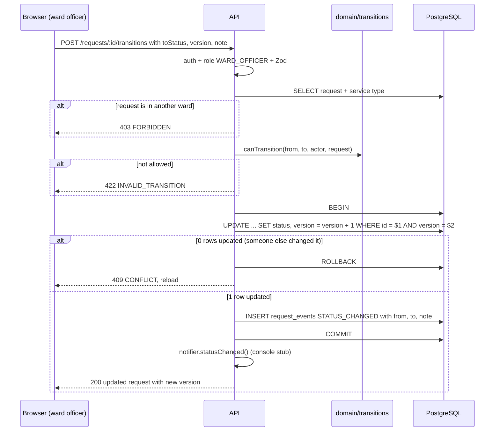

### 6.6 Two officers at the same time (why optimistic locking) 🔜
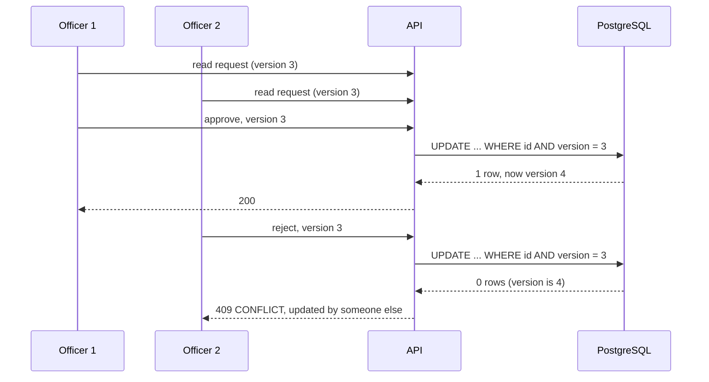
Without the version check, Officer 2 would silently overwrite Officer 1's decision. An
integration test fires both requests at once and expects exactly one 200 and one 409.

### 6.7 National delay map 🔜
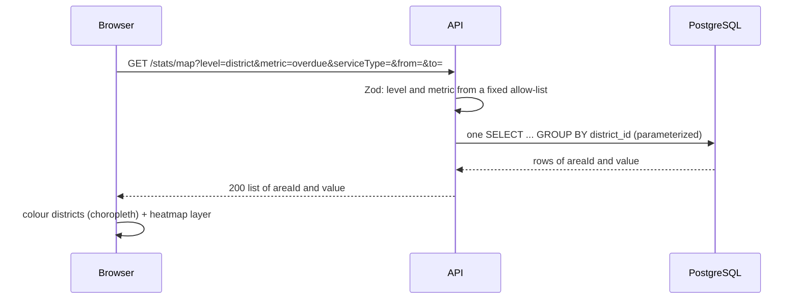
`level` and `metric` choose **which SQL** runs from a fixed list. They are never pasted into the
SQL string, so the query stays injection-safe.

---

## 7. Authentication and authorization

**Authentication (who are you?)** 🔜: phone + password → bcrypt check → JWT in an
`httpOnly` cookie (JavaScript can't read it, which protects against XSS token theft), 8-hour expiry.
The API is **stateless**: any API instance can verify the token, with no server-side session store.

**Authorization (what may you do?)** 🔜: checked on the server for every route.

| Action | Citizen | Ward officer | Palika admin | System admin | Public |
|---|---|---|---|---|---|
| Service catalog, track by code, public map | ✅ | ✅ | ✅ | ✅ | ✅ |
| Submit request | ✅ | — | — | — | — |
| See own requests | ✅ own | — | — | — | — |
| Resubmit / cancel | ✅ own, early states | — | — | — | — |
| Ward queue, request detail | — | ✅ own ward | ✅ own palika (read) | ✅ all (read) | — |
| Change status, mark fee paid | — | ✅ own ward | ❌ 403 | ❌ 403 | — |
| Reassign officer | — | — | ✅ own palika | ❌ | — |
| Admin map, reports | — | — | ✅ own palika | ✅ Nepal | — |

Scope is applied in two places: the guard rejects wrong roles, and repository queries filter by
the user's scope (e.g. `WHERE ward_id = $officerWardId`), so a missing check can't leak other
wards' data. The DB constraint `users_role_scope` guarantees every officer *has* a ward.

---

## 8. Data consistency

| Problem | Solution | Where |
|---|---|---|
| Status changed but no audit row (or the other way round) | Both in **one transaction** | services 🔜 |
| Two officers editing at once | **Optimistic locking** (`version`) → 409 | repositories 🔜 |
| Someone edits history | **Append-only trigger** on `request_events` | DB ✅ |
| Invalid values (status, scope, closed_at) | `CHECK` / FK / `UNIQUE` constraints | DB ✅ |
| Location changing after insert | Location ids copied once, never updated (ADR-001) | DB + repositories |
| Half-applied schema change | One transaction per migration + checksum + lock | migration runner ✅ |

**Why optimistic, not pessimistic (`SELECT … FOR UPDATE`) locking?** Officers read a request,
think, and act minutes later. Holding a row lock that long would block others. Conflicts are rare,
so detecting them at write time (and asking to reload) is cheaper and simpler.

---

## 9. Integration with the ID service

The mock (`apps/nid-mock`) 🔜 behaves like a real external service: random latency 100–1500 ms
and about 10% `503` errors.

| Rule | Value | Why |
|---|---|---|
| Timeout per call | 2 s | Never let a slow service hold our request |
| Retries | 2, with backoff 200 ms → 400 ms | Ride out short failures without hammering the service |
| On final failure | `identity_checks.status = FAILED` | Officer sees it; the citizen's submission still succeeded |
| Contract test | client's request/response shape vs the mock | A change in the mock's API breaks the build, not production |

**Trade-off:** the check runs in the background inside the API process after the response. If
the process restarts mid-check, the row stays `PENDING`. That's acceptable for a demo; a production
system would use a job queue with retries.

---

## 10. Errors, logging and observability

- **One error shape** for every failure: `{ "error": { code, message, details }, "requestId" }` ✅.
  Codes map to HTTP statuses in one place (`errors.ts`), shared with the web as types.
- **Unexpected errors** → `500 INTERNAL` with a generic message; the full error goes to the log only ✅.
- **Request id** on every request (`X-Request-Id` header and in error bodies) ✅, so a user's
  error report leads straight to the matching log lines.
- **Structured JSON logs** (pino) with **redaction** of passwords, tokens, cookies and applicant data ✅.
- **Health endpoint** `/api/v1/health` reports DB status, version and commit ✅, used by the
  host platform and the post-deploy smoke test.

---

## 11. Security and privacy

| Threat | Control | Status |
|---|---|---|
| SQL injection | Only parameterized queries (`$1, $2`); dynamic choices from allow-lists | ✅ rule, applied to all SQL |
| Invalid / malicious input | Zod validation on every body, query, param; 100 KB body limit | ✅ base · 🔜 per endpoint |
| Broken access control | Server-side role + scope checks; DB scope constraint | 🔜 · DB ✅ |
| Credential stuffing / brute force | Rate limit on login (5/min/IP) and tracking (10/min/IP) | 🔜 |
| Token theft via XSS | JWT in `httpOnly` cookie; Secure in prod; `SameSite=Lax` | 🔜 |
| Guessable ids / codes | `uuid` ids; random tracking codes | ✅ schema |
| Data leaks | Public tracking selects a fixed minimal field list; no PII in logs | 🔜 · logs ✅ |
| Stack traces / SQL errors exposed | Generic 500 message | ✅ |
| Common web attacks (clickjacking, sniffing) | `helmet` security headers | ✅ |
| Secrets in Git | `.env` ignored; only `.env.example`; gitleaks before going public | ✅ |
| Real personal data | Fake data only, `DEMO-` ids, consent checkbox, demo banner, periodic reset | 🔜 |

---

## 12. Performance and scalability

- **Connection pool** (max 10) reuses DB connections ✅.
- **Copied location ids** make map stats a single-table `GROUP BY` (ADR-001) ✅ schema.
- **Composite indexes** for the officer queue and map, measured with `EXPLAIN ANALYZE` on 100k rows 🔜.
- **Targets (PRD §10):** stats endpoint p95 < 200 ms, queue p95 < 150 ms locally on 100k rows.
- **Pagination** on lists (20 per page) 🔜.
- **Stateless API** (JWT, no in-memory sessions): more API instances can run behind a load balancer.
- **Next step if load grew (not in v1):** cache public map aggregates for a minute, a read
  replica for reports, a job queue for ID checks and notifications.

---

## 13. Deployment and CI/CD

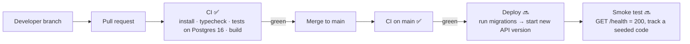

| Environment | Database | API / nid-mock | Web |
|---|---|---|---|
| Local ✅ | Docker Postgres 16 (`sewa_track`, `sewa_track_test`) | `tsx watch` | `next dev` 🔜 |
| CI ✅ | Postgres 16 service container | tests in-process (Supertest) | build only 🔜 |
| Demo 🔜 (proposed, PRD §11) | Neon (managed Postgres) | Render | Vercel, rewriting `/api/*` to the API |

Secrets (DB URL, JWT secret, deploy hooks) live in the hosting platform and GitHub Secrets,
never in the repo. Migrations run as a release step before the new API version starts.
`pnpm demo:reset` re-seeds the demo database on a schedule 🔜.

---

## 14. Key decisions and trade-offs

| Decision | Chosen | Alternative | Why |
|---|---|---|---|
| Repo layout | pnpm monorepo | separate repos | Shared types, one PR changes API + web together |
| DB access | `pg` + hand-written SQL | ORM (Prisma) | Every query visible and tunable; the core value is in SQL |
| Migrations | Own small runner | Flyway, node-pg-migrate | Same model as Flyway, no JVM, fully explainable |
| Location on requests | Copied ids (ADR-001) | Join through ward | Fast single-table stats; correct history |
| Concurrency | Optimistic locking (ADR-002) | Row locks | No long-held locks; clear 409 for rare conflicts |
| Audit immutability | DB trigger | "Just don't write delete code" | Guaranteed even for manual SQL |
| Status rules | Pure function in `domain/` | DB triggers / scattered `if`s | One place, unit-tested, easy to read |
| Auth | JWT in httpOnly cookie | Server sessions | Stateless API; safe from JS token theft |
| Web ↔ API | Same-origin proxy | CORS + cross-site cookies | Cookies work with `SameSite=Lax`; simpler security |
| ID check | Background with timeout/retry (ADR-003) | Block submission | Citizens aren't blocked by an outside outage |

Formal write-ups: `docs/decisions/ADR-001-denormalized-location.md`, `ADR-002-optimistic-locking.md`,
`ADR-003-mock-nid-integration.md` 🔜.

---

## 15. Build status

| Area | Status |
|---|---|
| Monorepo, shared package, CI | ✅ |
| API skeleton: health, error format, request id, logging, graceful shutdown | ✅ |
| Database schema, constraints, append-only trigger, migration runner | ✅ |
| Reference seed: 7/77/753 locations, 6,743 wards, 5 service types | ✅ |
| Demo users and demo requests | 🔜 P4–P5 |
| Domain rules (transitions, overdue, tracking code, fee payment) | ✅ |
| Auth: login/logout/me, JWT cookie, roles, rate limit, demo users | ✅ |
| Catalog and location endpoints | ✅ |
| Requests: submit + my requests | ✅ |
| Public tracking | ✅ |
| Staff queue and request detail | ✅ |
| Requests: transitions, fee | 🔜 P5 |
| Stats and map endpoint | 🔜 P6 |
| Web app | 🔜 P7 |
| Performance work, deploy, README | 🔜 P8 |
| NID mock + contract test, Swagger, ADRs | 🔜 P9 |
