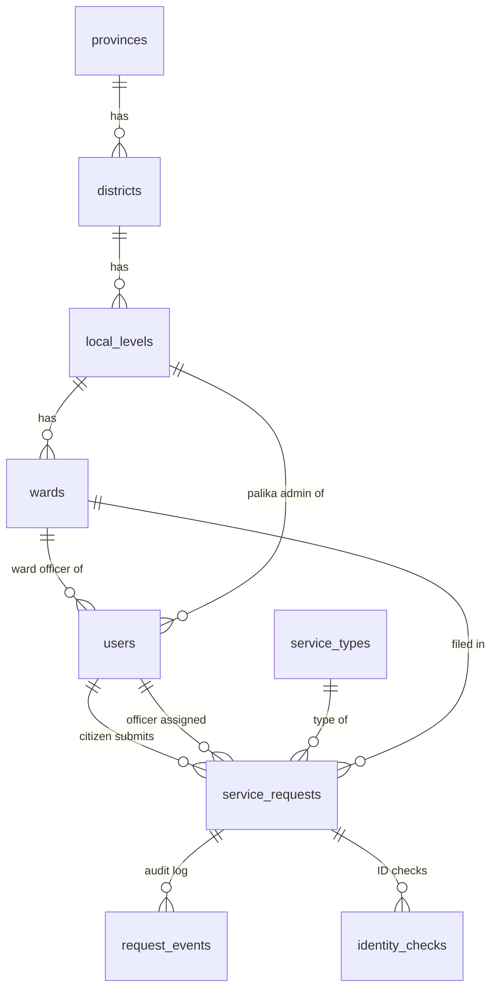

# Database Guide

> **Demo / portfolio project. All data is fake.**

PostgreSQL 16, accessed with `pg` (node-postgres) and **hand-written SQL**: no ORM.
Schema changes are plain `.sql` migration files applied by a small runner we wrote.

- Schema source of truth: [`apps/api/db/migrations/`](../apps/api/db/migrations/)
- Runner: [`apps/api/src/db/migrate.ts`](../apps/api/src/db/migrate.ts)
- Requirements: [`PRD.md` §8](./PRD.md#8-data-model)

---

## 1. Tables at a glance



| Table | What it holds | Notes |
|---|---|---|
| `provinces` | 7 provinces | Fixed ids 1–7 |
| `districts` | 77 districts | `province_id` FK |
| `local_levels` | 753 palikas | `type` (METRO…RURAL_MUNICIPALITY), centroid `lat/lng` for the map |
| `wards` | Wards per palika | `UNIQUE (local_level_id, number)`; `lat/lng` are generated demo points |
| `users` | Demo accounts | Role + scope; `password_hash` only (bcrypt) |
| `service_types` | The 5 services | Demo fee (integer NPR) and `service_days` (charter promise) |
| `service_requests` | The core table | Status, copied location ids, `version` for locking |
| `request_events` | Audit log | **Append-only** (trigger) |
| `identity_checks` | Mock National ID results | PENDING / MATCH / NO_MATCH / FAILED |
| `schema_migrations` | Which migration files ran | Created by the runner |

---

## 2. Design decisions

### Constraints are the last line of defence
Every rule that can be expressed in the database is: `NOT NULL`, `CHECK`, `FOREIGN KEY`, `UNIQUE`.
Even if the API has a bug, or someone edits data by hand, invalid data is refused.

| Rule | Constraint |
|---|---|
| Status / role / service code must be a known value | `CHECK (status IN (...))`, etc. (must match `packages/shared/src/enums.ts`) |
| Tracking code format `ST-` + 10 Crockford Base32 chars | `CHECK (tracking_code ~ '^ST-[0-9A-HJKMNP-TV-Z]{10}$')` |
| `closed_at` set **exactly** when the status is final | `service_requests_closed_matches_status` |
| Each role has exactly its scope (officer → ward, palika admin → palika) | `users_role_scope` |
| Fee ≥ 0, service days > 0, purpose 10–500 chars | `CHECK`s |
| One "Ward 5" per palika | `UNIQUE (local_level_id, number)` |

### Ids
- `uuid` (`gen_random_uuid()`) for users and requests: ids are not guessable, unlike 1, 2, 3.
- `GENERATED ALWAYS AS IDENTITY` for wards, events and identity checks: the modern SQL-standard form of `serial`.
- `bigint` for `request_events`: the fastest-growing table.
- Fixed `smallint` ids for provinces/districts: official numbering, not generated.

### Copied location ids (ADR-001)
`service_requests` stores `ward_id`, `local_level_id`, `district_id`, `province_id`, copied at
insert and never changed. The map counts per district with a plain `GROUP BY district_id`,
with no joins up the hierarchy, and history stays correct even if boundaries change later.

### Optimistic locking (ADR-002)
`version integer DEFAULT 0`. Every update:

```sql
UPDATE service_requests
SET status = $3, version = version + 1, updated_at = now()
WHERE id = $1 AND version = $2      -- the version the officer saw
RETURNING *;
```

0 rows updated → someone else changed it first → API returns `409 CONFLICT`.
No row locks held while an officer reads the page.

### Append-only audit log
A trigger on `request_events` raises an error on any `UPDATE` or `DELETE`:

```sql
CREATE TRIGGER request_events_append_only
  BEFORE UPDATE OR DELETE ON request_events
  FOR EACH ROW EXECUTE FUNCTION request_events_block_changes();
```

So "append-only" is guaranteed by the database, not just by "we didn't write a delete endpoint".
(`TRUNCATE`, used only by the demo reset, is a different command and still works.)

### Money and time
- Money: `integer` NPR. Never `float` (0.1 + 0.2 ≠ 0.3 in floating point).
- Time: `timestamptz`, stored in UTC; the UI shows Asia/Kathmandu with BS + AD dates.

### Indexes: added later, on purpose
`001_init.sql` only has the indexes that `PRIMARY KEY` and `UNIQUE` create automatically.
Performance indexes (officer queue, map stats) come in a later migration so
`docs/performance.md` can show `EXPLAIN ANALYZE` **before and after** on 100k rows.

---

## 3. Migrations

### Files
```
apps/api/db/migrations/
  001_init.sql        initial schema
  002_...sql          next change (never edit 001 after merge)
```

### Commands
```bash
pnpm db:migrate                                       # apply pending migrations to DATABASE_URL
docker compose exec db psql -U sewa -d sewa_track     # SQL shell
#   \dt                      list tables
#   \d service_requests      show columns, constraints, indexes
#   SELECT * FROM schema_migrations;
```

### How the runner works (`src/db/migrate.ts`)
1. Takes a Postgres **advisory lock**, so two runners (e.g. two deploys) never migrate at the same time.
2. Creates `schema_migrations (name, checksum, applied_at)` if missing.
3. Reads `db/migrations/*.sql` sorted by name.
4. For each file not yet applied: `BEGIN` → run file → insert into `schema_migrations` → `COMMIT`.
   On any error: `ROLLBACK`, and the schema is unchanged.
5. For files already applied: compares the SHA-256 **checksum**. If the file was edited
   after it was applied, it stops with an error.

Tests: `test/globalSetup.ts` runs the same runner on the **test** database before all tests.

### Adding a schema change
1. Create `apps/api/db/migrations/00N_short_name.sql`.
2. `pnpm db:migrate` locally; `pnpm test` (the test DB is migrated automatically).
3. Update this document in the same PR.

---

## 4. Tests for the schema

`apps/api/test/schema.test.ts` checks the database itself, without API code:

- migrations are idempotent (a second run applies nothing)
- all tables exist
- a valid request is accepted, with defaults `status = SUBMITTED`, `version = 0`
- bad tracking code, unknown status, `closed_at`/status mismatch, officer without ward,
  negative fee are all rejected
- `request_events` allows `INSERT` but blocks `UPDATE` and `DELETE`

Each test runs in a transaction that is **rolled back**, so no test data is left behind.
Expected failures run inside a `SAVEPOINT` (in Postgres, one failed statement aborts the
whole transaction; rolling back to the savepoint lets the test continue).
