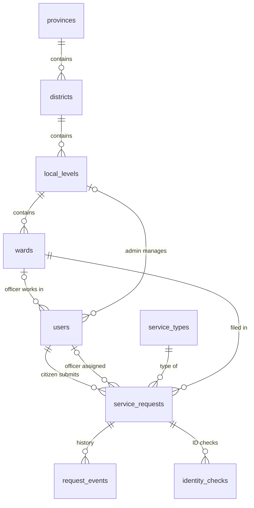
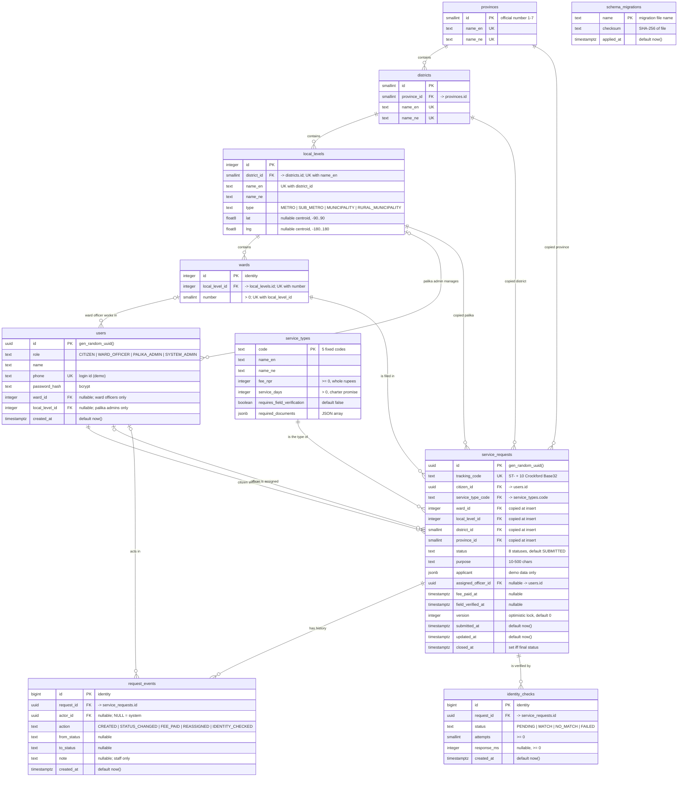

# Database Guide

> **Demo / portfolio project. All data is fake.**

PostgreSQL 16, accessed with `pg` (node-postgres) and **hand-written SQL**: no ORM.
Schema changes are plain `.sql` migration files applied by a small runner we wrote.

- Schema source of truth: [`apps/api/db/migrations/`](../apps/api/db/migrations/)
- Runner: [`apps/api/src/db/migrate.ts`](../apps/api/src/db/migrate.ts)
- Requirements: [`PRD.md` §8](./PRD.md#8-data-model) · System design: [`architecture.md`](./architecture.md)

> Diagrams are written in **Mermaid**. GitHub renders them automatically. In VS Code, install the
> "Markdown Preview Mermaid Support" extension, then open the preview (`Ctrl+Shift+V`).

## Contents

1. [Domain model in plain words](#1-domain-model-in-plain-words)
2. [Entity–relationship diagrams (overview + full with data types)](#2-entityrelationship-diagram-full-with-data-types)
3. [Relationships and cardinality](#3-relationships-and-cardinality)
4. [Relational schema (compact notation)](#4-relational-schema-compact-notation)
5. [Tables in detail](#5-tables-in-detail)
6. [Data types used and why](#6-data-types-used-and-why)
7. [Design decisions](#7-design-decisions)
8. [Normalization and the one deliberate exception](#8-normalization-and-the-one-deliberate-exception)
9. [Indexes](#9-indexes)
10. [Migrations](#10-migrations)
11. [Seed data (reference data)](#11-seed-data-reference-data)
12. [Tests for the schema and seed](#12-tests-for-the-schema-and-seed)

---

## 1. Domain model in plain words

- Nepal is divided into **7 provinces → 77 districts → 753 local levels (palikas) → wards**.
- A **user** has one **role**. A ward officer belongs to one ward; a palika admin to one palika;
  citizens and the system admin have no location scope.
- The **service catalog** lists 5 kinds of ward recommendation letters, each with a demo fee
  and the number of days the citizen charter promises.
- A citizen files a **service request** for one service type in one ward. It moves through a
  workflow of **statuses** until it is issued, rejected or cancelled.
- Every change to a request is written to the **audit log** (`request_events`), which can never
  be edited or deleted.
- Each request may have **identity checks** against a mock National ID service.

---

## 2. Entity–relationship diagram (full, with data types)

### 2.1 Overview (tables and relationships only)

Read top to bottom: the location hierarchy, then who works where, then requests and their history.



(The copied `local_level_id`, `district_id`, `province_id` links from `service_requests` are left
out here for readability; they are in the full diagram below and explained in §8.)

### 2.2 Full diagram (every column, type and key)

Legend: **PK** primary key · **FK** foreign key · **UK** unique. Quoted text = constraint or meaning.
`float8` = `double precision`.



`schema_migrations` has no relationships: it belongs to the migration runner, not the domain.

---

## 3. Relationships and cardinality

How to read the symbols: `||` exactly one · `|o` zero or one · `o{` zero or many.

| Parent | Child (FK column) | Cardinality | Required? | Meaning |
|---|---|---|---|---|
| `provinces` | `districts.province_id` | 1 : N | yes | Every district is in exactly one province |
| `districts` | `local_levels.district_id` | 1 : N | yes | Every palika is in exactly one district |
| `local_levels` | `wards.local_level_id` | 1 : N | yes | Every ward is in exactly one palika |
| `wards` | `users.ward_id` | 0..1 : N | no | Only ward officers have a ward (`users_role_scope`) |
| `local_levels` | `users.local_level_id` | 0..1 : N | no | Only palika admins have a palika (`users_role_scope`) |
| `users` | `service_requests.citizen_id` | 1 : N | yes | Every request has exactly one citizen |
| `users` | `service_requests.assigned_officer_id` | 0..1 : N | no | Officer set when review starts |
| `service_types` | `service_requests.service_type_code` | 1 : N | yes | Every request is one service type |
| `wards` / `local_levels` / `districts` / `provinces` | `service_requests.*_id` | 1 : N | yes | Location, copied at insert (see §8) |
| `service_requests` | `request_events.request_id` | 1 : N | yes | Full history of each request |
| `users` | `request_events.actor_id` | 0..1 : N | no | `NULL` = action by the system |
| `service_requests` | `identity_checks.request_id` | 1 : N | yes | One or more ID checks per request |

**No `ON DELETE CASCADE` anywhere.** Deleting a parent that still has children fails. Records
of public service are never removed silently; the demo reset uses `TRUNCATE` instead.

**Many-to-many?** None needed in v1: each user has one role and one scope, and each request has
one service type. (If a user could serve several wards, we would add a `user_wards` join table.)

---

## 4. Relational schema (compact notation)

The classic textbook form: **bold** = primary key, *italic* = foreign key (→ target).

- provinces(**id**, name_en, name_ne)
- districts(**id**, *province_id* → provinces, name_en, name_ne)
- local_levels(**id**, *district_id* → districts, name_en, name_ne, type, lat, lng)
- wards(**id**, *local_level_id* → local_levels, number)
- users(**id**, role, name, phone, password_hash, *ward_id* → wards, *local_level_id* → local_levels, created_at)
- service_types(**code**, name_en, name_ne, fee_npr, service_days, requires_field_verification, required_documents)
- service_requests(**id**, tracking_code, *citizen_id* → users, *service_type_code* → service_types,
  *ward_id* → wards, *local_level_id* → local_levels, *district_id* → districts, *province_id* → provinces,
  status, purpose, applicant, *assigned_officer_id* → users, fee_paid_at, field_verified_at,
  version, submitted_at, updated_at, closed_at)
- request_events(**id**, *request_id* → service_requests, *actor_id* → users, action, from_status, to_status, note, created_at)
- identity_checks(**id**, *request_id* → service_requests, status, attempts, response_ms, created_at)
- schema_migrations(**name**, checksum, applied_at)

---

## 5. Tables in detail

Columns marked **NN** are `NOT NULL`.

### 5.1 `provinces`: 7 rows, fixed
| Column | Type | Constraints | Why |
|---|---|---|---|
| `id` | `smallint` | PK | Official numbering 1–7, inserted by the seed (not generated). 2 bytes is enough. |
| `name_en` | `text` | NN, UNIQUE | English name for the UI |
| `name_ne` | `text` | NN, UNIQUE | Nepali name for the UI |

### 5.2 `districts`: 77 rows, fixed
| Column | Type | Constraints | Why |
|---|---|---|---|
| `id` | `smallint` | PK | Fixed numbering from the source dataset |
| `province_id` | `smallint` | NN, FK → provinces | Same type as the column it references |
| `name_en` | `text` | NN, UNIQUE | District names are unique in Nepal |
| `name_ne` | `text` | NN, UNIQUE | |

### 5.3 `local_levels`: 753 rows, fixed
| Column | Type | Constraints | Why |
|---|---|---|---|
| `id` | `integer` | PK | Fixed numbering from the source dataset |
| `district_id` | `smallint` | NN, FK → districts | |
| `name_en` | `text` | NN | Not unique on its own: the same name can appear in two districts |
| `name_ne` | `text` | NN | |
| `type` | `text` | NN, CHECK in 4 values | Metro / sub-metro / municipality / rural municipality |
| `lat`, `lng` | `double precision` | nullable, CHECK range, CHECK `local_levels_coordinates_pair` | Centroid for the map. `NULL` until a verified official-2020-map boundary file is added (migration 002); never half a pair |
| — | — | UNIQUE (`district_id`, `name_en`) | A name appears at most once per district |

### 5.4 `wards`: 6,743 rows (no coordinates)
| Column | Type | Constraints | Why |
|---|---|---|---|
| `id` | `integer` | PK, `GENERATED ALWAYS AS IDENTITY` | No national ward id exists, so we generate one |
| `local_level_id` | `integer` | NN, FK → local_levels | |
| `number` | `smallint` | NN, CHECK > 0 | Ward 1, 2, 3… inside the palika |
| — | — | UNIQUE (`local_level_id`, `number`) | "Ward 5" exists once per palika |

### 5.5 `users`
| Column | Type | Constraints | Why |
|---|---|---|---|
| `id` | `uuid` | PK, default `gen_random_uuid()` | Random, not guessable from the URL |
| `role` | `text` | NN, CHECK in 4 roles | Decides what the user may do |
| `name` | `text` | NN | Demo names only ("Ward Officer (Demo)") |
| `phone` | `text` | NN, UNIQUE | Login id; demo numbers outside real mobile ranges. `text`, not a number: no arithmetic, may have leading zeros |
| `password_hash` | `text` | NN | bcrypt hash; the password itself is never stored |
| `ward_id` | `integer` | FK → wards, nullable | Scope of a ward officer |
| `local_level_id` | `integer` | FK → local_levels, nullable | Scope of a palika admin |
| `created_at` | `timestamptz` | NN, default `now()` | |
| — | — | CHECK `users_role_scope` | Officer → ward only; palika admin → palika only; others → neither |

### 5.6 `service_types`: 5 rows
| Column | Type | Constraints | Why |
|---|---|---|---|
| `code` | `text` | PK, CHECK in 5 codes | Natural key: readable (`RESIDENCE`) and stable |
| `name_en`, `name_ne` | `text` | NN | Bilingual names |
| `fee_npr` | `integer` | NN, CHECK ≥ 0 | **Demo** fee in whole rupees; integers avoid float rounding errors |
| `service_days` | `integer` | NN, CHECK > 0 | **Demo** charter promise; overdue = `now() > submitted_at + service_days` |
| `requires_field_verification` | `boolean` | NN, default false | Decides whether `FIELD_VERIFICATION` is an allowed step |
| `required_documents` | `jsonb` | NN, default `[]`, CHECK is array | `[{nameEn, nameNe}]` checklist; only displayed, never queried, so JSON is simpler than a table |

### 5.7 `service_requests`: the core table
| Column | Type | Constraints | Why |
|---|---|---|---|
| `id` | `uuid` | PK, default random | Internal id used in staff URLs |
| `tracking_code` | `text` | NN, UNIQUE, CHECK regex | Public code `ST-XXXXXXXXXX`; random so codes can't be guessed in sequence |
| `citizen_id` | `uuid` | NN, FK → users | Owner of the request |
| `service_type_code` | `text` | NN, FK → service_types | |
| `ward_id` | `integer` | NN, FK → wards | Where it was filed |
| `local_level_id` | `integer` | NN, FK → local_levels | **Copied** from the ward at insert |
| `district_id` | `smallint` | NN, FK → districts | **Copied**; used by the district map |
| `province_id` | `smallint` | NN, FK → provinces | **Copied** |
| `status` | `text` | NN, default `SUBMITTED`, CHECK in 8 | Current workflow state. *Allowed moves* are checked in code (`domain/transitions.ts`) |
| `purpose` | `text` | NN, CHECK 10–500 chars | Why the letter is needed |
| `applicant` | `jsonb` | NN | `{ name, nid: "DEMO-…" }`, demo data only, never shown publicly |
| `assigned_officer_id` | `uuid` | FK → users, nullable | Set when review starts; palika admin can reassign |
| `fee_paid_at` | `timestamptz` | nullable | `NULL` = unpaid. A timestamp also records *when* |
| `field_verified_at` | `timestamptz` | nullable | Required before approval for field-visit services |
| `version` | `integer` | NN, default 0, CHECK ≥ 0 | Optimistic locking counter |
| `submitted_at` | `timestamptz` | NN, default `now()` | Start of the service clock |
| `updated_at` | `timestamptz` | NN, default `now()` | Last change |
| `closed_at` | `timestamptz` | nullable | When a final status was reached |
| — | — | CHECK `service_requests_closed_matches_status` | `closed_at` is set **exactly** when status ∈ {ISSUED, REJECTED, CANCELLED} |

### 5.8 `request_events`: audit log, append-only
| Column | Type | Constraints | Why |
|---|---|---|---|
| `id` | `bigint` | PK, identity | Fastest-growing table, so 8-byte ids |
| `request_id` | `uuid` | NN, FK → service_requests | |
| `actor_id` | `uuid` | FK → users, nullable | `NULL` = system action (e.g. identity check) |
| `action` | `text` | NN, CHECK in 5 | What happened |
| `from_status`, `to_status` | `text` | nullable | Filled for status changes |
| `note` | `text` | nullable | Officer note/reason. **Staff only**; never on public tracking |
| `created_at` | `timestamptz` | NN, default `now()` | |
| — | trigger | `request_events_append_only` | Any `UPDATE`/`DELETE` raises an error |

### 5.9 `identity_checks`
| Column | Type | Constraints | Why |
|---|---|---|---|
| `id` | `bigint` | PK, identity | |
| `request_id` | `uuid` | NN, FK → service_requests | |
| `status` | `text` | NN, CHECK in 4 | `FAILED` = service unreachable after retries |
| `attempts` | `smallint` | NN, default 0, CHECK ≥ 0 | 1 call + up to 2 retries |
| `response_ms` | `integer` | CHECK ≥ 0, nullable | Latency, for monitoring the integration |
| `created_at` | `timestamptz` | NN, default `now()` | |

### 5.10 `schema_migrations` (created by the runner)
| Column | Type | Constraints | Why |
|---|---|---|---|
| `name` | `text` | PK | File name, e.g. `001_init.sql` |
| `checksum` | `text` | NN | SHA-256 of the file; detects edits after apply |
| `applied_at` | `timestamptz` | NN, default `now()` | |

---

## 6. Data types used and why

| Type | Size | Used for | Why this and not something else |
|---|---|---|---|
| `smallint` | 2 B | province/district ids, ward number, attempts | Small fixed ranges; saves space in big tables (`service_requests.district_id`) |
| `integer` | 4 B | palika/ward ids, fee, days, version, response_ms | Default whole number |
| `bigint` | 8 B | `request_events.id`, `identity_checks.id` | Tables that grow without limit |
| `uuid` | 16 B | users, requests | Random, not guessable, can be created anywhere without a central counter |
| `text` | variable | names, codes, statuses, notes | In Postgres `text` = `varchar` in speed; length rules go in `CHECK` |
| `boolean` | 1 B | `requires_field_verification` | True/false flag |
| `double precision` | 8 B | lat/lng | Approximate decimals are fine for coordinates (never for money) |
| `jsonb` | variable | document list, applicant | Small structured data read as a whole; binary JSON is validated and indexable if ever needed |
| `timestamptz` | 8 B | all times | Stores an exact moment in UTC; avoids time-zone bugs. Plain `timestamp` has no zone and is ambiguous |

**Why `text` + `CHECK` instead of Postgres `ENUM` types?** Adding a value to an `ENUM` needs
`ALTER TYPE` and has restrictions inside transactions; a `CHECK` list is changed with a normal
migration and reads the same in every SQL tool.

---

## 7. Design decisions

### 7.1 Constraints are the last line of defence
Every rule that can be expressed in the database is: `NOT NULL`, `CHECK`, `FOREIGN KEY`, `UNIQUE`.
Even if the API has a bug, or someone edits data by hand, invalid data is refused.

| Rule | Constraint |
|---|---|
| Status / role / service code must be a known value | `CHECK (status IN (...))`, etc. (must match `packages/shared/src/enums.ts`) |
| Tracking code format `ST-` + 10 Crockford Base32 chars | `CHECK (tracking_code ~ '^ST-[0-9A-HJKMNP-TV-Z]{10}$')` |
| `closed_at` set **exactly** when the status is final | `service_requests_closed_matches_status` |
| Each role has exactly its scope | `users_role_scope` |
| Fee ≥ 0, service days > 0, purpose 10–500 chars | `CHECK`s |
| One "Ward 5" per palika | `UNIQUE (local_level_id, number)` |

**What the database does *not* check:** which status may follow which (e.g. SUBMITTED → APPROVED
is invalid). That rule depends on the actor and on other fields, so it lives in one pure,
unit-tested function: `domain/transitions.ts`.

### 7.2 Ids
- `uuid` (`gen_random_uuid()`) for users and requests: not guessable, unlike 1, 2, 3.
- `GENERATED ALWAYS AS IDENTITY` for wards, events and identity checks: the SQL-standard form of `serial`.
- Fixed `smallint`/`integer` ids for provinces, districts, palikas: stable numbering from the source data.

### 7.3 Optimistic locking (ADR-002)
```sql
UPDATE service_requests
SET status = $3, version = version + 1, updated_at = now()
WHERE id = $1 AND version = $2      -- the version the officer saw
RETURNING *;
```
0 rows updated → someone else changed it first → API returns `409 CONFLICT`.
No row locks are held while an officer reads the page.

### 7.4 Append-only audit log
```sql
CREATE TRIGGER request_events_append_only
  BEFORE UPDATE OR DELETE ON request_events
  FOR EACH ROW EXECUTE FUNCTION request_events_block_changes();
```
"Append-only" is guaranteed by the database, not just by "we didn't write a delete endpoint".
(`TRUNCATE`, used only by the demo reset, is a different command and still works.)

### 7.5 Status change + audit in one transaction
```sql
BEGIN;
  UPDATE service_requests SET status = ..., version = version + 1 WHERE id = $1 AND version = $2;
  INSERT INTO request_events (request_id, actor_id, action, from_status, to_status, note) VALUES (...);
COMMIT;   -- both rows are saved, or (on any error) neither is
```

### 7.6 Money and time
- Money: `integer` NPR. Never `float` (`0.1 + 0.2 = 0.30000000000000004`).
- Time: `timestamptz` in UTC; the UI shows Asia/Kathmandu with BS + AD dates.

---

## 8. Normalization and the one deliberate exception

The schema is in **third normal form (3NF)**: every non-key column depends on the key, the whole
key, and nothing but the key. Names live once (in `provinces`, `districts`…), service rules live
once (in `service_types`), and requests point to them by id.

**The exception (ADR-001):** `service_requests` stores `local_level_id`, `district_id` and
`province_id`, although they could be derived from `ward_id` through three joins.

| | Strict 3NF (derive via joins) | Our choice (copy at insert) |
|---|---|---|
| Map query | `JOIN wards → local_levels → districts`, then `GROUP BY` | `GROUP BY district_id` on one table |
| Index for map | Can't index across joins | One composite index `(district_id, status, submitted_at)` |
| If boundaries change later | Old requests move to the new district | Old requests keep their original location (correct history) |
| Risk | — | Copies could disagree with the ward |

The risk is controlled because the copied ids are **set once at insert, from the ward row, and
never updated**. That makes this a safe, documented *denormalization* for read performance.

---

## 9. Indexes

**Created automatically by `001_init.sql`** (every `PRIMARY KEY` and `UNIQUE` makes a B-tree index):

| Table | Index on | Used for |
|---|---|---|
| all tables | primary key | Lookups by id |
| `service_requests` | `tracking_code` | Public tracking lookup |
| `users` | `phone` | Login |
| `wards` | `(local_level_id, number)` | Ward lookup inside a palika |
| `local_levels` | `(district_id, name_en)` | Palika lookup inside a district |
| `provinces`, `districts` | `name_en`, `name_ne` | Name lookups |

**Not automatic:** Postgres does **not** index foreign key columns. Planned in a later migration
(with `EXPLAIN ANALYZE` before/after in `docs/performance.md`):

| Planned index | For |
|---|---|
| `service_requests (ward_id, status, submitted_at)` | Officer queue: "my ward, this status, oldest first" |
| `service_requests (district_id, status, submitted_at)` | Map stats per district |
| `request_events (request_id, created_at)` | Request timeline |

---

## 10. Migrations

### Files
```
apps/api/db/migrations/
  001_init.sql                   initial schema
  002_location_coordinates.sql   wards: drop lat/lng; local_levels: lat/lng nullable, both-or-neither
  003_...sql                     next change (never edit an applied file)
```

### Commands
```bash
pnpm db:migrate                                       # apply pending migrations to DATABASE_URL
docker compose exec db psql -U sewa -d sewa_track     # SQL shell
#   \dt                      list tables
#   \d service_requests      show columns, constraints, indexes
#   SELECT * FROM schema_migrations;
```

### How the runner works (`src/db/migrate.ts`)
1. Takes a Postgres **advisory lock**, so two runners (e.g. two deploys) never migrate at the same time.
2. Creates `schema_migrations (name, checksum, applied_at)` if missing.
3. Reads `db/migrations/*.sql` sorted by name.
4. For each file not yet applied: `BEGIN` → run file → insert into `schema_migrations` → `COMMIT`.
   On any error: `ROLLBACK`, and the schema is unchanged.
5. For files already applied: compares the SHA-256 **checksum**. If the file was edited
   after it was applied, it stops with an error.

This is the same model as Flyway (`flyway_schema_history` with checksums), written in Node to
avoid a JVM dependency.

Tests: `test/globalSetup.ts` runs the same runner on the **test** database before all tests.

### When to run migrations
| Situation | Action |
|---|---|
| New or wiped database | `pnpm db:migrate` |
| Pulled a branch with a new migration file | `pnpm db:migrate` |
| Wrote a new migration | `pnpm db:migrate`, then `pnpm test` |
| Tests / CI | Automatic (global setup) |
| Deploy | Automatic release step before the new API version starts |

### Adding a schema change
1. Create `apps/api/db/migrations/00N_short_name.sql`.
2. `pnpm db:migrate` locally; `pnpm test` (the test DB is migrated automatically).
3. Update this document in the same PR.

---

## 11. Seed data (reference data)

`pnpm db:seed` loads the data every environment needs (run `pnpm db:migrate` first):

| Table | Rows | Source |
|---|---|---|
| `provinces` | 7 | `db/seed-data/locations.json` |
| `districts` | 77 | same |
| `local_levels` | 753 | same (no coordinates yet) |
| `wards` | 6,743 | generated from each palika's ward count |
| `service_types` | 5 | `db/seed-data/service-types.json` (**demo values**) |
| `users` | 6 | `db/seed-data/demo-users.json`: **fake** demo accounts, password hashed with scrypt at seed time |

Location data comes from [local-states-nepal](https://github.com/sagautam5/local-states-nepal)
(MIT), pinned to one commit, checked against official figures, with one Nepali spelling fix. Details
and the license notice: [`apps/api/db/seed-data/README.md`](../apps/api/db/seed-data/README.md).
`locations.json` is produced by `pnpm --filter @sewa/api import:locations` and committed, so seeding
never needs the internet.

**How `src/db/seed.ts` works:**
- **One transaction**: all tables load, or none do.
- **One INSERT per table**: the whole JSON array is sent as one parameter and turned into rows with
  `jsonb_to_recordset($1::jsonb) AS x(id smallint, "nameEn" text, ...)`. 753 rows = 1 query, not 753.
- **Wards from a count**: `CROSS JOIN LATERAL generate_series(1, x.wards)` turns "Kathmandu has 32
  wards" into 32 rows, so one INSERT creates all 6,743 wards.
- **Idempotent upserts**: `ON CONFLICT (id) DO UPDATE SET ... = EXCLUDED....` updates rows that already
  exist; wards use `ON CONFLICT DO NOTHING`. Running the seed again changes nothing.
- **Non-destructive**: never deletes, so it's safe on a database that already has requests.

Demo accounts: phones start with `90` (not a real Nepali mobile prefix), names end in "(Demo)". A ward
officer's ward is resolved by `(palika id, ward number)` with a `LEFT JOIN`. Demo requests come in a later phase.

---

## 12. Tests for the schema and seed

`apps/api/test/schema.test.ts` checks the database itself, without API code:

- migrations are idempotent (a second run applies nothing)
- all tables exist
- a valid request is accepted, with defaults `status = SUBMITTED`, `version = 0`
- bad tracking code, unknown status, `closed_at`/status mismatch, officer without ward,
  negative fee, half a coordinate pair are all rejected
- `request_events` allows `INSERT` but blocks `UPDATE` and `DELETE`

`apps/api/test/seed.test.ts` checks the seed: 7 / 77 / 753 / 6,743; the official mix of palika types
(6 / 11 / 276 / 460); Kathmandu has wards 1–32; the corrected Nepali spelling; the 5 service types;
and that running the seed again changes nothing. The test database is migrated **and seeded** once
by `test/globalSetup.ts`.

Each test runs in a transaction that is **rolled back**, so no test data is left behind.
Expected failures run inside a `SAVEPOINT` (in Postgres, one failed statement aborts the
whole transaction; rolling back to the savepoint lets the test continue).
